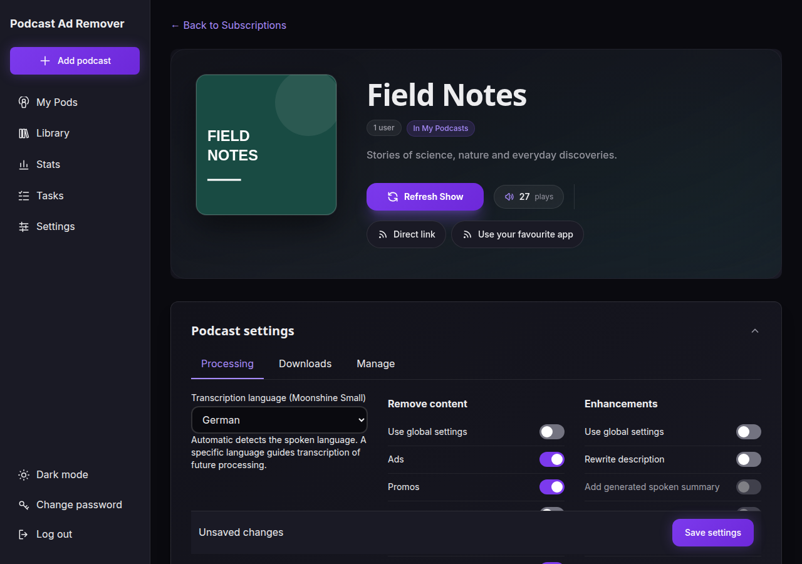
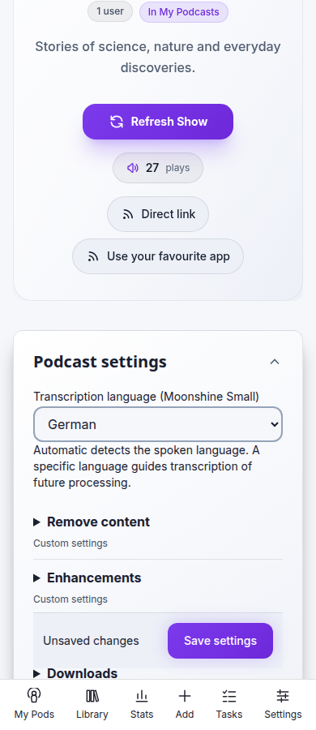

# NAS fork: language, Moonshine Small and YAMNet

This fork builds a CPU service for the low-memory NAS. New podcasts and existing
podcasts default to **Automatic**. The podcast settings page offers **English**
and **German**; owners/admins can also PATCH the subscription settings API with
`{"language":"en"}`, `{"language":"de"}` or `{"language":"auto"}`.
Changing a language applies to future jobs and invalidates ordinary transcript
cache reuse. Explicit “reuse transcript” requests deliberately retain the old
transcript. Existing published episodes are not changed automatically.

The container defaults to `TRANSCRIPTION_ENGINE=moonshine`. Explicit languages
select the corresponding **Moonshine Small Streaming quantized** model (not the
larger default English model). Automatic uses Whisper Tiny int8 on the first
90 seconds for language detection, releases it, then selects Moonshine English
or German. A different detected language fails with an actionable message; this
fork currently supports these two transcription languages. Music-only openings
can confuse detection: choose the language explicitly for those podcasts.
Whisper Tiny downloads into the persistent `/data/models` cache on its first
automatic job. Explicit-language jobs need no Whisper model.

Moonshine processes two-minute windows with four seconds of context on either
side. Native segment timestamps become the transcript timeline; overlapping
alternatives are conservatively grouped using the existing seam logic. Each
model runs in a child process that exits before the next model loads. Progress
callbacks retain the existing job cancellation checks between windows.

YAMNet v1 then reads mono 16 kHz audio in batches of 64 frames, with 0.48-second
hops and a 0.25 score threshold. It retains Music, Theme music, Jingle (music),
Background music, Singing and Speech scores. Scores describe acoustic evidence,
not ad probability. Gaps are split at evidence boundaries; speech text is never
split or duplicated. Evidence overlapping speech is retained too. The complete
chronological timeline, including uncovered gaps, reaches the classifier before
existing deterministic cut preferences are applied. The evidence version and
source identity participate in caching. A failed sound stage fails the job
rather than silently classifying without the requested evidence.

The image downloads YAMNet and both Moonshine models at build time. Local
inference can override `YAMNET_MODEL_DIR` and `MOONSHINE_MODELS_DIR`; image defaults
are `/opt/yamnet` and `/opt/moonshine`. `TRANSCRIPTION_ENGINE=whisper` retains the
upstream Whisper path and honors the same podcast language hint on CPU/CUDA and
long-episode chunking. Whisper settings in the upstream System UI apply only to
that fallback, not the Moonshine model selection.

## Build and verify

Use Python 3.11 and the Node/npm environment described in VERIFICATION.md:

```bash
pip install -r requirements-dev.txt
npm ci
npm run verify
uvx ruff check .
uvx ruff format --check .
docker build -t podcast-ad-remover:language-yamnet .
```

Ruff is scoped to the new fork modules/tests. The download scripts fetch the
official versioned model endpoints. Never copy the production `/data` into a
build context. Run container qualification against disposable synthetic data
before deployment; live processing must retain one-job concurrency on the NAS.

## Compatibility and rollback

Formal migration `20261029_0028_podcast_language` adds a checked TEXT column with
`auto` as its default. Existing data is preserved and the upstream migration
mechanism takes a WAL-safe database backup before upgrading an existing DB.
Back up application data and retain the outgoing image before deployment.
Rollback uses the matching pre-upgrade database/data snapshot and outgoing image;
do not overwrite newly produced episodes with an old snapshot while running.
The new column is additive, but a matching restore is the supported rollback.

The upstream registry updater must be replaced with the fork's local image
policy or it will overwrite these features. No upstream release or `latest` tag
is published by this work.

## Qualification limits

Synthetic English speech was transcribed correctly by the real English Small
model. Both EN/DE models loaded, and real YAMNet inference completed across batch
boundaries. Workstation silence smoke tests peaked at about 403 MiB for German
Moonshine and 602 MiB for YAMNet, in separate processes. These are smoke-test
measurements, not full-podcast accuracy or NAS memory acceptance. Representative
English/German podcasts, music/jingle detection and final cut quality still need
listening review. German model loading alone does not establish German accuracy.

The full verification gate passed with 848 tests, CSS build and both dependency
audits. The new module Ruff checks passed. Both desktop and 390px mobile form
checks passed, including form submission data and the Save button state.



